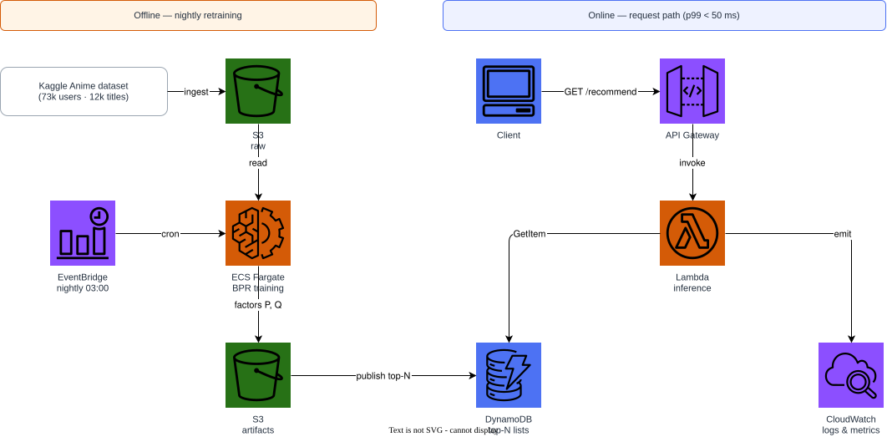
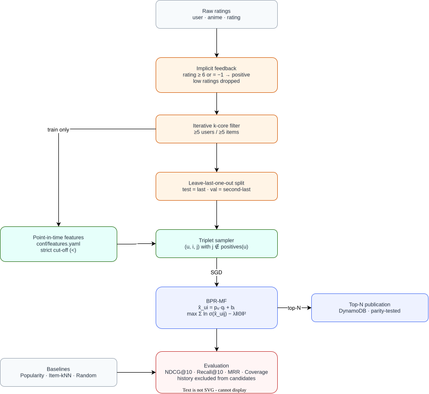

# Anime BPR Recommender

Implicit-feedback recommender for the
[Anime Recommendations Database](https://www.kaggle.com/datasets/CooperUnion/anime-recommendations-database),
trained with **Bayesian Personalized Ranking (BPR)** matrix factorization.

Kaggle notebooks for this dataset are dominated by rating-prediction and
cosine-similarity tutorials. This project deliberately treats the problem as
**ranking from implicit feedback** instead: the model never tries to predict
the value of a rating, it learns to order a consumed item above an unconsumed
one for each user.

| Property | Value |
|---|---|
| Portfolio ID | `S04` (saturated domain) |
| Implementation order | 2 of 23 (complexity level 1) |
| Main method | BPR matrix factorization with SGD |
| Primary metric | NDCG@10 |
| Serving | Batch top-N export to S3 + DynamoDB lookup |

## Problem statement

Given a set of users $\mathcal{U}$, anime titles $\mathcal{I}$, and observed
interactions $\mathcal{R}$, produce for each user a ranked list of $K$ titles
they have not watched, maximizing ranking quality on held-out interactions.

Explicit ratings in the raw file are converted to implicit feedback: a rating
of `-1` means "watched but not rated" and is kept as a positive signal, while
a low rating is treated as a weak positive rather than a negative. True
negatives are unobserved, which is precisely the assumption BPR encodes.

## Method

BPR maximizes the posterior probability that a user prefers an observed item
$i$ over an unobserved item $j$:

$$
\mathcal{L} = \sum_{(u,i,j) \in D_S} \ln \sigma(\hat{x}_{ui} - \hat{x}_{uj})
  - \lambda \lVert \Theta \rVert^2
$$

with the matrix factorization scoring function

$$
\hat{x}_{ui} = \mathbf{p}_u^\top \mathbf{q}_i + b_i .
$$

Full derivation, gradients, and complexity analysis are in
[`paper/main.tex`](paper/main.tex).

## Quickstart

```bash
python -m venv .venv && source .venv/bin/activate
pip install -e ".[dev]"

# 1. Get data (synthetic fixture by default, no Kaggle account needed)
python scripts/download_data.py --synthetic

# 2. Build leakage-safe features
python scripts/build_features.py

# 3. Train and evaluate
python -m recommender.cli train
python -m recommender.cli evaluate

# 4. Export top-N recommendations
python -m recommender.cli recommend --user-id 3 --k 10
```

To use the real dataset instead of the fixture:

```bash
export KAGGLE_USERNAME=... KAGGLE_KEY=...
python scripts/download_data.py --kaggle
```

Credentials are read from the environment and are never written to the repo.

## Architecture

### AWS deployment



Batch training runs locally or on a scheduled container, writes model
artifacts and precomputed top-N lists to S3, and loads the lists into DynamoDB
for low-latency lookup by a Lambda behind API Gateway.

### Recommendation flow



Both diagrams are editable: [`docs/aws-architecture.drawio`](docs/aws-architecture.drawio)
and [`docs/recommendation-architecture.drawio`](docs/recommendation-architecture.drawio).

Regenerate them with:

```bash
python -m venv .diagram-venv && .diagram-venv/bin/pip install drawpyo
.diagram-venv/bin/python scripts/generate_diagrams.py
docker run --rm -v "$PWD/docs":/data -w /data rlespinasse/drawio-export \
  -f svg -o . --output-mode relative --remove-page-suffix .
docker run --rm -v "$PWD/docs":/data -w /data rlespinasse/drawio-export \
  -f png -o . --output-mode relative --remove-page-suffix .
# Never pass -t/--transparent to the PNG export above: it drops the white
# background and the diagram turns invisible on GitHub's light theme.
# The exporter writes as root; reclaim ownership before committing.
docker run --rm -v "$PWD/docs":/data alpine chown -R "$(id -u):$(id -g)" /data
```

## Feature engineering

Features are declared in [`conf/features.yaml`](conf/features.yaml) and
implemented in `src/recommender/features/`. Every aggregate is computed
**point-in-time**: only interactions strictly before the prediction timestamp
contribute.

| Feature | Family | Rationale | Used at |
|---|---|---|---|
| `user_activity_count` | interaction | Separates heavy watchers from casual ones; drives confidence weighting | Training |
| `user_rating_mean` | interaction | Captures user leniency so low ratings are interpreted relative to the user | Training |
| `item_popularity_rank` | item | Popularity prior for cold-start users and the popularity baseline | Both |
| `item_member_count` | item | Catalog-side audience size, available before any interaction | Both |
| `item_genre_tokens` | text | Content signal that lets unseen titles still be scored | Cold start |
| `user_genre_affinity` | interaction | Time-decayed taste profile over genres | Training |

Rejected features are documented in `paper/sections/03-feature-engineering.tex`
together with the measured effect that justified removing them.

### Leakage controls

`tests/test_features_leakage.py` asserts that:

1. Injecting an interaction **after** the cut-off does not change any feature.
2. Popularity and encoding tables are fitted on the training partition only.
3. Shuffling labels collapses NDCG@10 to the random baseline.

## Evaluation

Leave-last-one-out per user with a temporal cut-off; the most recent
interaction of each user forms the test set and the one before it the
validation set.

| Model | NDCG@10 | Recall@10 | MRR@10 | Coverage |
|---|---|---|---|---|
| Item-kNN cosine baseline | **0.1305** | 0.2483 | 0.0952 | 0.4969 |
| BPR (this project) | 0.1248 | 0.2339 | 0.0922 | 0.3937 |
| Most-popular baseline | 0.0761 | 0.1448 | 0.0556 | 0.0750 |
| Random | 0.0150 | 0.0334 | 0.0095 | 1.0000 |

Numbers are generated by `python scripts/export_results_table.py` so the
README, the paper, and the code cannot drift apart.

### The baseline wins, and that is the reported result

A properly tuned item-kNN beats tuned BPR here by about 4.6% NDCG. This is
kept rather than tuned away. Both models were given the same grid budget on
the **validation** partition, and the test partition was read once.

The regime explains it: ~900 users over 320 items, left dense by the k-core
filter, with latent structure that is a handful of taste clusters crossed
with a popularity prior. Item-kNN represents within-cluster co-consumption
almost exactly, while BPR must recover it through a rank-*d* approximation
fitted by sampled SGD. Re-running at ~5x scale compressed the gap without
reversing it. See `paper/sections/06-results.tex` for the full analysis.

This mirrors [Dacrema et al. (2019)](https://dl.acm.org/doi/10.1145/3298689.3347058),
who found most neural recommenders they reproduced were beaten by well-tuned
baselines — usually because the baselines in the original papers were never
tuned at all.

## Infrastructure

```bash
docker compose up -d
terraform -chdir=terraform init
terraform -chdir=terraform validate
terraform -chdir=terraform apply -auto-approve
pytest
terraform -chdir=terraform destroy -auto-approve
docker compose down
```

Terraform targets the local Floci AWS emulator at `http://localhost:4566` with
dummy credentials, so the default path costs nothing and needs no AWS account.
Real-AWS deployment is documented as an optional profile in
`terraform/README.md`.

## Cost and cleanup

| Resource | Local (Floci) | Real AWS estimate |
|---|---|---|
| S3 artifacts | $0 | < $0.05/month for < 1 GB |
| DynamoDB top-N table | $0 | On-demand, < $1/month at low traffic |
| Lambda inference | $0 | Free tier covers demo traffic |

`terraform destroy` plus `docker compose down` removes everything. The
`.floci/` volume can be deleted to reclaim disk.

## Paper

The full methodology, equations, feature ablation, and results are in
[`paper/main.pdf`](paper/main.pdf) (12 pages). Build it with:

```bash
make -C paper tables   # regenerate tables from the code
make -C paper          # needs a local LaTeX toolchain
make -C paper docker   # or build in a container
```

## License and data

Code is MIT licensed. The dataset is distributed by Kaggle under its own
terms and is **not** redistributed here; `scripts/download_data.py` fetches it
on demand or generates a synthetic fixture with the same schema.
